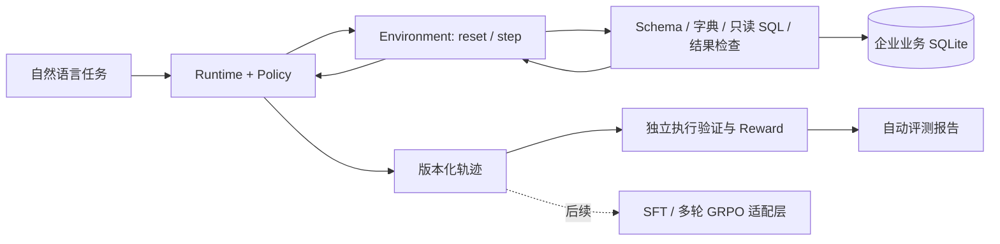

# EnterpriseAgent-RL

基于多轮工具调用与可验证反馈的企业数据分析 Agent 后训练工程。

**当前版本：Milestone 0–1 的 CPU 可运行基础。** 已实现真实 SQLite 工具执行、多轮环境、轨迹采集/回放、程序化奖励、离线评测和 FastAPI。默认使用已知任务模板的确定性策略，无 GPU、模型权重或 API Key 也能验收完整流程。**尚未执行 Base LLM、SFT 或 GRPO 实验，没有模型能力提升结论。**

## 快速运行

已验证环境：Linux x86_64、Python 3.12.7、glibc 2.17。源码要求 Python 3.11–3.12；依赖锁定文件的实际验收环境是 Python 3.12。无需 Docker 或 PostgreSQL。

```bash
bash scripts/setup/bootstrap.sh
source .venv/bin/activate
ruff check .
ruff format --check .
pytest -q
python scripts/evaluation/cpu_smoke.py
```

安装脚本仅写入项目 `.venv`。若集群默认代理无法访问 PyPI，可在当前安装命令前使用 `env -u HTTPS_PROXY -u HTTP_PROXY -u ALL_PROXY -u https_proxy -u http_proxy -u all_proxy`；不要永久修改系统网络配置。完整固定版本见 `requirements/cpu-py312-linux.lock`，本地包使用 `--no-deps --no-build-isolation` 安装。

```bash
earl --config configs/agent/cpu.toml init-db
earl --config configs/agent/cpu.toml evaluate --split test --output artifacts/fixture-test
earl --config configs/agent/cpu.toml evaluate --split test --policy fixture-recovery --output artifacts/recovery-test
earl compare artifacts/fixture-test/report.json artifacts/recovery-test/report.json
earl replay artifacts/fixture-test/trajectories/<run_id>.json
```

`init-db` 通过独占创建保护已有文件；重复运行时不会覆盖数据库。需要另一份数据时用 `--database artifacts/another.sqlite3`。CPU smoke 使用临时目录，可直接重复执行。轨迹和评测输出保存在忽略提交的 `artifacts/` 中。

集群计算节点验收：从仓库根目录运行 `sbatch scripts/slurm/cpu_smoke.sbatch`。该脚本只申请 `freecpuQ`、1 核、2 GB、最多 5 分钟，不使用 GPU。已完成作业及结果见 [验收记录](docs/validation.md)。

## 可运行的业务流程



数据库包含区域、客户、产品、订单、订单明细五张关联表，96 个订单，含取消、待支付及从未下单客户。金额用整数分，收入只计已支付订单的成交价快照。

10 个合成任务分为 train=4、validation=1、test=5；覆盖区域收入、先查订单数量再求客户 Top-3、未购买客户及产品类别收入。确定性策略从业务提示词识别已知模板，并依据工具结果继续查询、修复故意注入的字段错误、检查证据和结束。它不是通用自然语言模型；未知模板会显式失败。

SQL 在独立受限进程中运行：只读数据库 URI、`query_only`、表/函数授权白名单、禁用扩展、禁止写入/ATTACH/PRAGMA、墙钟与 CPU 超时、256 MB 地址空间上限、默认 100 行/64 KiB 输出上限，并记录查询哈希审计。截断结果不能作为完成证据。此边界针对受控合成数据库；生产环境还需要数据库角色、服务鉴权与部署隔离，详见架构文档。

奖励在 episode 结束后用独立参考查询验证，答案不会通过环境反馈给策略。默认只对最终正确且满足业务约束的任务给 1 分；效率、重复调用及恢复项可配置，失败任务始终为 0。完整语义见 [架构说明](docs/architecture.md)。

## API 示例

```bash
earl serve --port 8000
# 在另一个终端：
python examples/api_client.py
```

打开本机 [OpenAPI 文档](http://127.0.0.1:8000/docs)。默认绑定 loopback、单进程，适用于本地演示；没有公开部署。

| 接口 | 用途 |
|---|---|
| `POST /tasks` | 提交自然语言任务并选择策略版本 |
| `GET /tasks/{id}` | 查询 queued/running/completed/failed 状态及奖励 |
| `GET /tasks/{id}/trajectory` | 获取完整执行证据 |
| `GET /models` | 当前注册的策略版本及 fixture/local_llm 类型 |
| `GET /benchmarks` | 公开任务和划分，不含参考 SQL |
| `POST /comparisons` | 对同一任务提交多个版本，返回可轮询任务 ID |
| `GET /health` | 服务状态 |

提供 `benchmark_task_id` 时 prompt 必须与该公开任务严格一致，才执行隐藏验证；自定义 prompt 的 reward 为 null，标为 `unscored_custom_prompt`。`completed` 表示执行完成，是否业务正确应查看 `reward.success`。状态写入独立 SQLite；服务重启后未完成任务标为 `server_restarted`，已完成轨迹可继续查询。

## 真实本地模型接口

`LocalModelPolicy` 已实现 OpenAI 兼容 JSON 聊天端点适配，逐轮提交完整可见历史，记录模型返回的 token 使用量。CLI 和 API 均可选择模型版本。调用必须位于 Slurm 作业内，端点仅允许本计算节点的 loopback HTTP；本次只验证传输协议和登录节点拦截，没有加载 Qwen。

```bash
# 仅在后续获准的 Slurm 计算节点作业内，已有模型端点启动后：
earl --config configs/agent/cpu.toml evaluate --policy local   --endpoint http://127.0.0.1:8001/v1/chat/completions   --model Qwen2.5-1.5B-Instruct --policy-version qwen-base-r1   --split test --output artifacts/qwen-base-r1
# 或把该版本注册到 Agent API：
earl serve --local-endpoint http://127.0.0.1:8001/v1/chat/completions   --model Qwen2.5-1.5B-Instruct --policy-version qwen-base-r1
```

模型服务端的 Transformers FP16/eager 路径、显存和速度验证属于 Milestone 2；不能把客户端协议测试解释为模型兼容性通过。没有安装 vLLM、FlashAttention、TRL 或 verl。依赖选择依据及真实上游源码版本见 [上游调研](docs/upstream-research.md)。

## 当前结果与路线图

首轮 CPU CLI 对照中，5 个 test split 任务的 fixture 和恢复 fixture 均完成 5/5。正常策略平均 4.2 次工具调用；恢复策略 5.2 次，SQL 可执行率为 6/11，因为每个任务故意先产生一次 SQL 错误。该结果验证系统恢复链路；不表示模型准确率。token 为 0，费用按配置中的零单价计算，未计集群账单。详情与原始聚合指标见 [CPU 实验](experiments/cpu-mvp/README.md)。

| 阶段 | 状态与下一交付 |
|---|---|
| M0 | 仓库、环境审计、架构、包/配置/日志/测试/锁定依赖已落地；GPU 设备级信息待计算节点采集 |
| M1 | CPU 工具、环境、策略、轨迹、奖励、评测、API 贯通并验收 |
| M2 | 待开展：单卡短作业采集设备信息，再验证 Qwen FP16、多轮推理、SFT/GRPO 最小步 |
| M3 | 待开展：扩大任务集、严格隔离 SFT 训练/验证/测试、LoRA SFT 与恢复 |
| M4 | 待开展：真实环境 rollout、经过验证的上游 GRPO、Base/SFT/RL 与奖励消融 |
| M5 | 待开展：部署、模型版本对照、完整实验报告及基于真实证据的简历总结 |

更多说明：[环境审计](docs/environment-audit.md)、[系统架构](docs/architecture.md)、[实施记录与交接](docs/implementation-log.md)、[下一阶段](docs/roadmap.md)。模型、数据库、数据集、Checkpoint、日志和敏感配置均不提交 Git。
